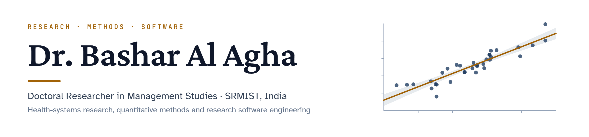

  <picture>
    <source media="(prefers-color-scheme: dark)" srcset="assets/banner-dark.png">
    <source media="(prefers-color-scheme: light)" srcset="assets/banner-light.png">
    
  </picture>

  
  
  
  
  

## About

I am a doctoral researcher in Management Studies at the Faculty of Management, SRM Institute of Science and Technology (SRMIST), Chennai, India. My doctoral research (PhD in Healthcare Management and Evidence-Based Decision Making, 2025–2028) focuses on international healthcare systems and strategic expansion models: global healthcare strategy, health service internationalization and healthcare ecosystem development. My background bridges the clinical and management sciences: **BDS** (Damascus University), **BPharm** (Marwadi University), **Master in Pharmacology** (Saurashtra University) and **PGDM** (BIMTECH).

Alongside the research I build software: tools that make rigorous quantitative analysis faster and reproducible, and web platforms for education, health services and scholarly publishing.

<table>
  <tr>
    <th align="left" width="33%">Research</th>
    <th align="left" width="33%">Methods</th>
    <th align="left" width="34%">Engineering</th>
  </tr>
  <tr>
    <td valign="top">Global healthcare strategy Health service internationalization Healthcare ecosystem development Evidence-based healthcare management One Health Healthcare management and marketing</td>
    <td valign="top">PLS-SEM and CB-SEM fsQCA and NCA Data envelopment analysis Panel data and causal inference Time-series econometrics Meta-analysis and bibliometrics</td>
    <td valign="top">TypeScript, React, Next.js, Angular Go, PHP (Laravel), Python, R PostgreSQL, MySQL, Elasticsearch, Redis Docker, Vercel, Cloudflare Workers AI-agent and research-automation pipelines</td>
  </tr>
</table>

## Flagship: Arwad

<a href="https://github.com/Bashar444/arwad"><b>Arwad: R, compiled.</b></a> A statistical programming language that keeps R's syntax and the CRAN ecosystem, and compiles numerical work to native code with deterministic, garbage-collection-free memory (built on the [Goose](https://github.com/aardappel/goose) systems language). In the Phase 0 benchmark, its first kernel, called from R, ran a 10,000-replicate bootstrap 1.59× faster than R's fastest loop while allocating 46× less memory, and matched GNU R to 15 significant digits.

[Design](https://github.com/Bashar444/arwad/blob/main/docs/ARCHITECTURE.md) &middot; [Roadmap](https://github.com/Bashar444/arwad/blob/main/docs/ROADMAP.md) &middot; [Benchmark report](https://github.com/Bashar444/arwad/blob/main/bench/phase0/REPORT.md) &middot; MIT licence

## Selected projects (live)

<table>
  <tr>
    <td width="50%" valign="top">
      <a href="https://github.com/Bashar444/virtual-teaching-platform"><b>VTP: Virtual Teaching Platform</b></a> 
      Arabic-first (RTL) virtual classroom for the Syrian secondary curriculum: live sessions, assignments, attendance and role dashboards. 
      <code>Go</code> <code>TypeScript</code> <code>PostgreSQL</code> <code>PWA</code> &middot; <a href="https://vtp-mu.vercel.app">Live</a>
    </td>
    <td width="50%" valign="top">
      <a href="https://omn-omega.vercel.app"><b>Omnium</b></a> 
      A complete professional ecosystem: one platform for profiles, work and collaboration, under active development. 
      <code>TypeScript</code> <code>Next.js</code> &middot; <a href="https://omn-omega.vercel.app">Live</a>
    </td>
  </tr>
  <tr>
    <td width="50%" valign="top">
      <a href="https://github.com/Bashar444/medical-coordination-platform"><b>Medical Coordination Platform</b></a> 
      Arabic patient-coordination site connecting Syrian patients worldwide with advanced surgical and medical care in India. 
      <code>HTML</code> <code>CSS</code> <code>JavaScript</code> &middot; <a href="https://medical-tourism-website-beta.vercel.app">Live</a>
    </td>
    <td width="50%" valign="top">
      <a href="https://github.com/Bashar444/travel-ltd-admissions"><b>Travel.Ltd</b></a> 
      University-admission services for Syrian students: programme discovery and application support. 
      <code>React</code> <code>Vite</code> <code>shadcn/ui</code> &middot; <a href="https://travel-syria-visions.vercel.app">Live</a>
    </td>
  </tr>
</table>

## Ecosystem

| Platform | Role |
|---|---|
| [**Langwi**](https://langwi.com) | Software lab and showcase for my programming-language and developer projects, starting with Arwad (moving on from its earlier language-learning focus) |
| [**Palmyra Academic Press**](https://palmyrapub.org) | Academic publisher: journals, monographs and the methods papers behind my software |
| [**PalmyraDoor**](https://palmyradoor.tech) | Research portal in development: point-and-click statistical engines (PLS-SEM, DEA, panel models) running in the browser on Arwad |

## Open-source standard

New open-source projects start from [`mit-project-template`](https://github.com/Bashar444/mit-project-template): MIT licence, a `CITATION.cff` file for GitHub's *Cite this repository* button and Zenodo DOIs, continuous integration, Dependabot, and the shared community files in [`.github`](https://github.com/Bashar444/.github).

## Contact

- **Academic:** [ba8160@srmist.edu.in](mailto:ba8160@srmist.edu.in)
- **Personal:** [basharalagha21@gmail.com](mailto:basharalagha21@gmail.com) &middot; [alaghabashar0@gmail.com](mailto:alaghabashar0@gmail.com)
- **Alumni (BIMTECH):** [bashar.agha25@bimtech.ac.in](mailto:bashar.agha25@bimtech.ac.in)
- **ORCID:** [0009-0004-5178-2345](https://orcid.org/0009-0004-5178-2345) &middot; **LinkedIn:** [dr-bashar-al-agha](https://www.linkedin.com/in/dr-bashar-al-agha) &middot; **Portfolio:** [bashar-portfolio-six.vercel.app](https://bashar-portfolio-six.vercel.app)

Open to collaboration on research software, quantitative methods and health-systems analytics.

Related accounts: <a href="https://github.com/connexdotz">@connexdotz</a> (product engineering) &middot; <a href="https://github.com/Drbash6">@Drbash6</a> (research instruments and study materials)
